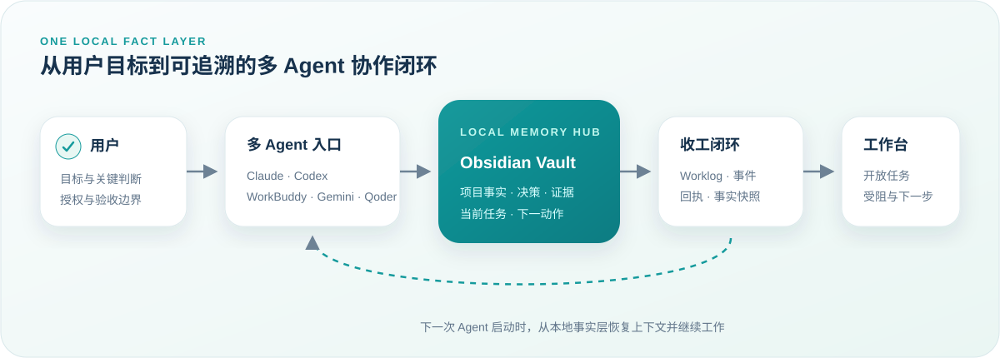

<div align="center">

# AI Agent Memory Hub

### 把项目事实、决策、证据和下一步留在本地，让不同 AI Agent 真正接续工作

**A local-first, agent-deployable memory and collaboration layer for your AI coding tools.**

[](https://www.python.org/)
[](https://obsidian.md/)
[](docs/platform-support.md)
[](docs/platform-support.md)
[](SECURITY.md)
[](LICENSE)

[把仓库交给 Agent](#把仓库交给-agent) · [查看工作原理](#工作原理) · [手动快速开始](#手动快速开始) · [部署文档](docs/agent-deployment.md)

</div>

---

## 为什么需要它

Claude Code 完成了分析，Codex 不知道关键决策；WorkBuddy 接手时，又要重新解释项目背景。聊天记录越来越长，但真正有用的事实、证据和下一步仍散落在不同工具里。

AI Agent Memory Hub 把这些内容沉淀到**用户拥有的本地 Obsidian Vault**，并为不同 Agent 提供同一套启动、执行、交接和收工规则。

> 它不是另一个聊天记录仓库，也不绑定某个模型。它是一层位于用户、Agent 和项目之间的本地协作记忆层。

| 常见问题 | Memory Hub 的处理方式 |
|---|---|
| 换一个 Agent 就要重新讲背景 | Claude、Codex、WorkBuddy 等读取同一份项目事实与当前任务 |
| “已经做完”却找不到证据 | 收工时记录状态、完成内容、下一步、证据路径和唯一回执 |
| 长期记忆混入猜测和聊天噪音 | 只写事实、决策、证据和可执行下一步，推断必须标明依据 |
| 安装脚本直接覆盖全局规则 | 先只读体检和生成计划，用户确认后才写受管区块，并自动备份 |
| 任务很多但看不清真正主线 | 网页或 Windows 桌面工作台展示开放任务、受阻项和下一动作 |

## 工作台预览

<p align="center">
  
</p>

<p align="center"><sub>左：Windows 桌面贴边形态；右：Windows / macOS 网页形态。由公共发行版在空白测试环境中生成，内容为脱敏示例数据。</sub></p>

工作台读取本地生成的 `operations_snapshot.json`，不使用在线演示数据替代用户事实。网页版本支持 Windows 与 macOS；贴边桌面版本使用 WPF + WebView2，仅支持 Windows 10/11。

## 核心优势

### 1. 多 Agent 共享一个事实源

支持 Claude Code、Codex、Gemini、WorkBuddy、Qoder 和 QoderWork。每个工具仍保留自己的能力与规则入口，但项目背景、当前任务和交接证据来自同一个 Vault。

### 2. 记忆不是“多存一些”，而是形成闭环

一次任务收工会同步产生：

- Obsidian 当日 worklog；
- 追加式任务事件；
- 当前任务看板；
- 唯一收工回执；
- 网页/桌面工作台快照。

状态保留 `active`、`waiting`、`blocked`、`handoff`、`stage-complete`、`completed` 和 `terminated` 的真实差异，不把“等待用户确认”伪装成“已完成”。

### 3. Agent 原生部署，而不是黑盒一键安装

目标用户已经在使用本地 Agent，因此本项目把部署说明写给 Agent：它先检查电脑，再与用户确认关键选择，最后执行并验证。用户不需要从头开发，也不需要盲目信任一个修改全局配置的安装器。

### 4. 可选的成长型 AI 协作协议

仓库包含通用的 [成长型 AI 协作协议 V3.2.1](protocols/growth-ai-collaboration-v3.2.1.md)。启用后，Agent 不只机械执行，还会在重要任务中区分事实、推断和待验证假设，识别可能改变路线的盲区，并把最终判断权留给用户。

### 5. 隐私边界从发行结构开始

公共仓库只发布机制、模板与工作台源码，不发布作者的 Vault、日报、项目页、Agent 私人规则、凭证或安装回执。用户记忆默认留在本机。

## 工作原理

<p align="center">
  
</p>

部署本身也遵循一个明确的权限闸门：

```text
只读体检 → 用户确认 4 个关键选择 → 生成 install-plan.json
         → 用户审阅并明确同意 → 写入规则/初始化 Vault → verify 验收
```

## 把仓库交给 Agent

下载 ZIP 或把仓库网址发给本地 Agent，然后直接粘贴：

```text
请阅读仓库根目录 AGENTS.md 和 docs/agent-deployment.md。
先执行只读体检，逐项向我确认 Vault、规则作用域、成长协议和工作台选择；
输出计划供我审阅，在我明确同意前不要修改任何全局规则或安装软件。
```

Agent 会与用户确认四个真正影响部署路线的问题：

1. 使用已有 Obsidian Vault，还是创建新的空 Vault；
2. 规则只对当前项目生效，还是写入指定 Agent 的全局规则；
3. 是否启用成长型 AI 协作协议 V3.2.1；
4. 不安装工作台、安装网页工作台，还是在 Windows 上安装桌面工作台。

完整流程见 [Agent 驱动部署说明](docs/agent-deployment.md)。

## 手动快速开始

要求：Python 3.11+。以下命令均在仓库根目录执行。

### 1. 只读检查环境

```bash
python -m memory_hub doctor --json
```

### 2. 生成计划，不修改电脑

```bash
python -m memory_hub plan \
  --vault "/absolute/path/to/vault" \
  --agent claude \
  --agent codex \
  --rule-scope global \
  --growth-mode enabled \
  --workbench web \
  --output install-plan.json
```

### 3. 审阅后明确安装

```bash
python -m memory_hub install --plan install-plan.json --yes
python -m memory_hub verify --vault "/absolute/path/to/vault"
```

已有规则文件不会被整体覆盖。工具只维护 `AI_MEMORY_HUB_RULES_V1` 区块，并把修改前版本备份到 `<Vault>/.memory-hub/backups/`。

### 4. 让 Agent 在任务结束时收工

```bash
python -m memory_hub close \
  --vault "/absolute/path/to/vault" \
  --task "任务名" \
  --status completed \
  --completed "已经完成并验证的内容" \
  --next-action "下一动作与负责人" \
  --evidence "相对 Vault 的证据路径"
```

## 平台与组件

| 能力 | Windows 10/11 | macOS | 说明 |
|---|---:|---:|---|
| Python CLI 与本地记忆链 | ✅ | ✅ | Python 3.11+，仅使用标准库 |
| Obsidian Vault | ✅ | ✅ | 推荐安装；Markdown 写入本身不强依赖 Obsidian |
| 网页工作台 | ✅ | ✅ | 使用本地 HTTP 服务，不需要云端后台 |
| 桌面工作台 | ✅ | — | WPF + WebView2，仅构建 `win-x64` |
| 成长型 AI 协作协议 | ✅ | ✅ | 安装计划中显式选择启用或关闭 |

详细边界见 [平台支持说明](docs/platform-support.md)。

## 仓库结构

```text
ai-agent-memory-hub/
├── memory_hub/                 # 体检、计划、安装、收工、快照与验收 CLI
├── protocols/                  # 通用成长型 AI 协作协议
├── workbench/
│   ├── web/                    # Windows / macOS 网页工作台
│   └── desktop-windows/        # Windows WPF + WebView2 桌面端
├── docs/                       # Agent 部署与平台说明
├── tests/                      # 隔离临时目录测试
├── AGENTS.md                   # Agent 通用部署入口
├── CLAUDE.md                   # Claude Code 入口
└── GEMINI.md                   # Gemini 入口
```

## 安全与诚实边界

- 体检阶段不安装软件、不创建 Vault、不修改 Agent 规则。
- 修改全局规则必须由用户明确授权。
- 不记录密码、API Key、cookie 或完整数据库连接串。
- 本项目不提供云同步、托管账号或远程记忆服务。
- `doctor` 检出的路径和命令只是线索；部署 Agent 仍需验证目标工具实际使用的规则入口。
- macOS 支持核心与网页工作台，不支持 Windows 桌面应用。

更多信息见 [SECURITY.md](SECURITY.md)。

## 验证方式

发行版使用三层证据验证，而不是以“文件生成成功”代替交付：

1. Python 单元测试验证规则保护、备份、状态和快照契约；
2. 空白临时环境验证 `plan → install → close → verify` 完整链路；
3. 真实浏览器验证工作台展示的任务、证据、受阻状态与下一动作；Windows 桌面源码另执行 .NET build/publish。

## 参与项目

欢迎通过 Issue 提交新的 Agent 规则入口、真实 macOS 验收结果、平台兼容问题或隐私边界建议。提交示例和截图前，请先移除个人 Vault 内容、绝对私人路径和凭证。

## License

[MIT License](LICENSE)——允许使用、复制、修改和再发布，但须保留版权与许可证声明；软件按现状提供，不承诺担保。
