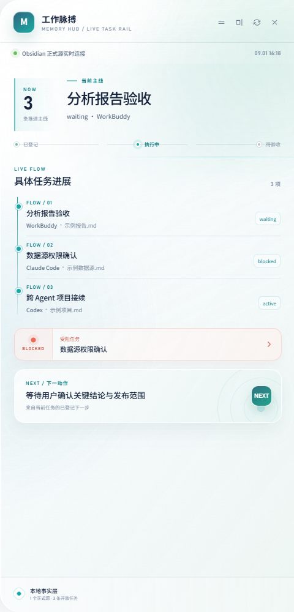
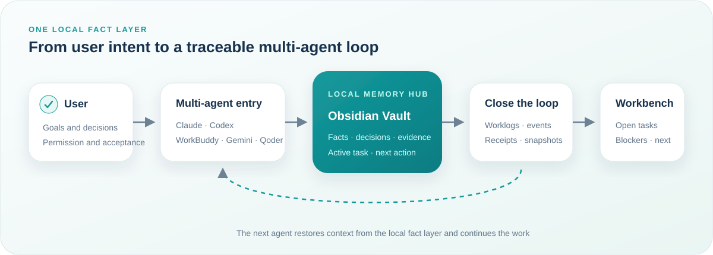

<div align="center">

**English** | [简体中文](README.zh-CN.md)

# AI Agent Memory Hub

### Keep project facts, decisions, evidence, and next actions local—so every AI agent can continue where the last one stopped

**A local-first, agent-deployable memory and collaboration layer for your AI coding tools.**

[](https://www.python.org/)
[](https://obsidian.md/)
[](docs/platform-support.md)
[](docs/platform-support.md)
[](SECURITY.md)
[](LICENSE)

[Give It to Your Agent](#give-the-repository-to-your-agent) · [How It Works](#how-it-works) · [Manual Quick Start](#manual-quick-start) · [Deployment Guide (Chinese)](docs/agent-deployment.md)

</div>

---

## Why This Exists

Claude Code finishes an analysis, but Codex does not know the key decisions. When WorkBuddy takes over, you have to explain the project again. The chat history keeps growing while the facts, evidence, and next actions that actually matter remain scattered across tools.

AI Agent Memory Hub stores them in a **local Obsidian Vault owned by the user** and gives different agents one shared protocol for startup, execution, handoff, and closure.

> This is not another chat archive, and it is not tied to any model. It is a local collaboration-memory layer between the user, their agents, and their projects.

| Common problem | How Memory Hub handles it |
|---|---|
| Switching agents means explaining everything again | Claude, Codex, WorkBuddy, and others read the same project facts and active task |
| A task is “done,” but nobody can find the evidence | Closure records the real status, completed work, next action, evidence paths, and a unique receipt |
| Long-term memory fills with guesses and chat noise | Only facts, decisions, evidence, and executable next steps are retained; inferences must state their basis |
| An installer overwrites global agent rules | The agent first runs a read-only inspection and produces a plan; managed blocks are written only after approval, with automatic backups |
| Many tasks exist, but the real main thread is unclear | The web or Windows desktop workbench shows open tasks, blockers, and next actions |

## Workbench Preview

<p align="center">
  
</p>

<p align="center"><sub>Left: docked Windows desktop mode. Right: web mode for Windows and macOS. The screenshot was generated from the public release in a clean test environment with sanitized sample data; the current workbench UI shown here is in Chinese.</sub></p>

The workbench reads a locally generated `operations_snapshot.json`; it does not replace user facts with online demo data. The web version supports Windows and macOS. The docked desktop version uses WPF + WebView2 and supports Windows 10/11 only.

## Core Strengths

### 1. One fact source shared by multiple agents

Claude Code, Codex, Gemini, WorkBuddy, Qoder, and QoderWork are supported. Each tool keeps its own capabilities and rule entry point, while project context, the active task, and handoff evidence come from the same Vault.

### 2. Memory is a closed loop, not just more storage

Closing a task produces:

- an Obsidian daily worklog;
- append-only task events;
- an active-task dashboard;
- a unique closure receipt;
- a web/desktop workbench snapshot.

The system preserves the real differences among `active`, `waiting`, `blocked`, `handoff`, `stage-complete`, `completed`, and `terminated`. “Waiting for user confirmation” is never disguised as “completed.”

### 3. Agent-native deployment instead of a black-box installer

The intended users already work with local agents, so this project writes the deployment procedure for those agents. The agent inspects the machine first, confirms the choices that matter, then installs and verifies. Users do not need to rebuild the system from scratch or blindly trust an installer that changes global configuration.

### 4. Optional Growth-Oriented AI Collaboration Protocol

The repository includes the reusable [Growth-Oriented AI Collaboration Protocol V3.2.1](protocols/growth-ai-collaboration-v3.2.1.md). When enabled, agents do more than mechanically execute: on important work they distinguish facts, inferences, and testable hypotheses; surface blind spots that may change the route; and leave final judgment to the user.

### 5. Privacy starts with the release structure

The public repository contains the mechanism, templates, and workbench source—not the author's Vault, daily notes, project pages, private agent rules, credentials, or installation receipts. User memory stays local by default.

## How It Works

<p align="center">
  
</p>

Deployment follows an explicit permission gate:

```text
Read-only inspection → confirm 4 key choices → generate install-plan.json
                     → user reviews and approves → write rules / initialize Vault → verify
```

## Give the Repository to Your Agent

Download the ZIP or send the repository URL to your local agent, then paste:

```text
Read AGENTS.md and docs/agent-deployment.md in the repository root.
Run a read-only environment inspection first. Ask me to confirm the Vault,
rule scope, growth protocol, and workbench options one by one.
Show me the plan for review. Do not modify global rules or install software
until I explicitly approve it.
```

The agent will confirm the four choices that materially affect deployment:

1. use an existing Obsidian Vault or create a new empty Vault;
2. apply rules to the current project only or to selected agents' global rules;
3. enable or disable the Growth-Oriented AI Collaboration Protocol V3.2.1;
4. install no workbench, the web workbench, or—on Windows—the desktop workbench.

See the complete [agent-driven deployment guide (Chinese)](docs/agent-deployment.md).

## Manual Quick Start

Requirement: Python 3.11+. Run all commands from the repository root.

### 1. Inspect the environment without changing it

```bash
python -m memory_hub doctor --json
```

### 2. Generate a plan without modifying the machine

```bash
python -m memory_hub plan \
  --vault "/absolute/path/to/vault" \
  --agent claude \
  --agent codex \
  --rule-scope global \
  --growth-mode enabled \
  --workbench web \
  --output install-plan.json
```

### 3. Review, then explicitly install

```bash
python -m memory_hub install --plan install-plan.json --yes
python -m memory_hub verify --vault "/absolute/path/to/vault"
```

Existing rule files are never overwritten wholesale. The tool manages only the `AI_MEMORY_HUB_RULES_V1` block and backs up the previous version under `<Vault>/.memory-hub/backups/`.

### 4. Let the agent close a task

```bash
python -m memory_hub close \
  --vault "/absolute/path/to/vault" \
  --task "Task name" \
  --status completed \
  --completed "Work that was completed and verified" \
  --next-action "Next action and owner" \
  --evidence "Evidence path relative to the Vault"
```

## Platforms and Components

| Capability | Windows 10/11 | macOS | Notes |
|---|---:|---:|---|
| Python CLI and local memory loop | ✅ | ✅ | Python 3.11+; standard library only |
| Obsidian Vault | ✅ | ✅ | Recommended; writing Markdown does not strictly require Obsidian |
| Web workbench | ✅ | ✅ | Uses a local HTTP service; no cloud backend required |
| Desktop workbench | ✅ | — | WPF + WebView2; built for `win-x64` only |
| Growth-Oriented AI Collaboration Protocol | ✅ | ✅ | Explicitly enabled or disabled in the install plan |

See [platform support](docs/platform-support.md) for the detailed boundaries.

## Repository Layout

```text
ai-agent-memory-hub/
├── memory_hub/                 # Inspection, planning, installation, closure, snapshots, verification
├── protocols/                  # Reusable Growth-Oriented AI Collaboration Protocol
├── workbench/
│   ├── web/                    # Web workbench for Windows and macOS
│   └── desktop-windows/        # Windows WPF + WebView2 desktop app
├── docs/                       # Agent deployment and platform documentation
├── tests/                      # Tests isolated in temporary directories
├── AGENTS.md                   # General agent deployment entry point
├── CLAUDE.md                   # Claude Code entry point
└── GEMINI.md                   # Gemini entry point
```

## Security and Honest Boundaries

- The inspection phase does not install software, create a Vault, or modify agent rules.
- Global rules are changed only with explicit user approval.
- Passwords, API keys, cookies, and full database connection strings are never recorded.
- This project does not provide cloud sync, hosted accounts, or remote memory services.
- Paths and commands detected by `doctor` are leads, not guarantees; the deploying agent must still verify which rule entry points the installed tools actually use.
- macOS supports the core and web workbench, not the Windows desktop application.

See [SECURITY.md](SECURITY.md) for more.

## How We Validate

The release uses three layers of evidence instead of treating “files were generated” as proof of delivery:

1. Python unit tests verify rule protection, backups, status semantics, and snapshot contracts.
2. A clean temporary environment verifies the complete `plan → install → close → verify` path.
3. A real browser verifies that the workbench renders tasks, evidence, blockers, and next actions; the Windows desktop source is separately built and published with .NET.

## Contributing

Issues are welcome for additional agent rule locations, real-world macOS acceptance results, platform compatibility problems, and privacy-boundary improvements. Before submitting examples or screenshots, remove personal Vault content, private absolute paths, and credentials.

## License

[MIT License](LICENSE)—you may use, copy, modify, and redistribute the project as long as the copyright and license notices are preserved. The software is provided as-is, without warranty.
